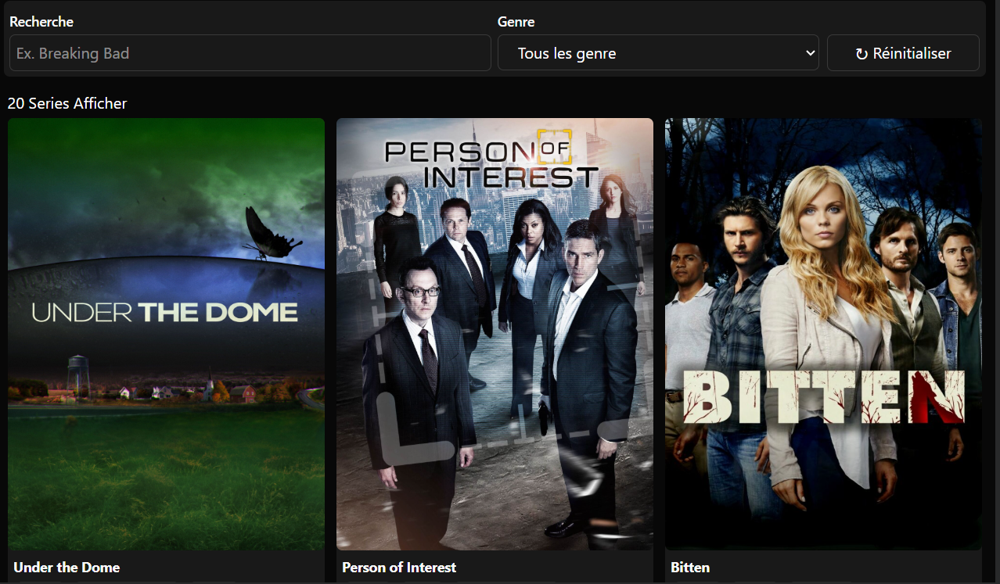
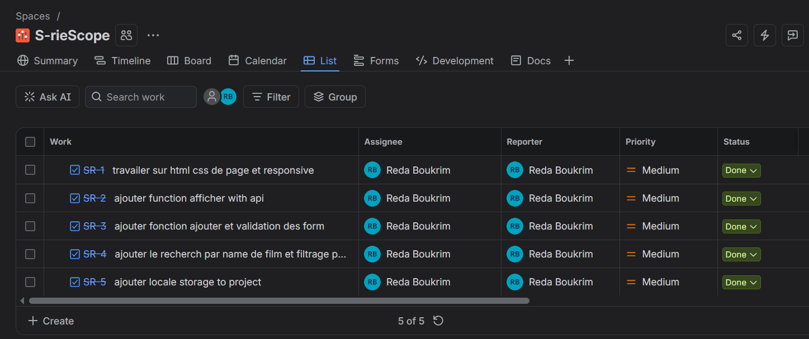

# S-rieScope-

##  Présentation du projet

**Movie & Series Library** est une application web permettant aux utilisateurs de découvrir, consulter et gérer une collection de films et de séries.

L'application offre une interface simple et intuitive permettant de visualiser les informations de chaque film ou série, notamment son titre, son genre et son résumé (*description*).

Les utilisateurs peuvent également ajouter de nouveaux contenus et rechercher leurs films et séries préférés.

##  Fonctionnalités principales

- **Affichage des films et séries :** Consulter une collection de films et de séries avec leurs informations et leurs résumés.
- **Ajout de films et séries :** Ajouter de nouveaux contenus à l'aide d'un formulaire.
- **Gestion des genres :** Sélectionner un genre lors de l'ajout d'un film ou d'une série.
- **Recherche :** Rechercher un film ou une série par son titre.
- **Filtrage par genre :** Afficher uniquement les films et séries appartenant au genre sélectionné.
- **Description :** Consulter un résumé pour chaque film ou série.

## 🛠️ Technologies utilisées

| Technologie | Utilisation |
|---|---|
| HTML5 | Structure de l'application |
| Tailwind CSS | Mise en forme et design responsive |
| JavaScript | Fonctionnalités et interactions dynamiques |
| Git & GitHub | Gestion de versions et collaboration |
| GitHub Pages | Hébergement de l'application |
| Jira | Gestion et suivi des tâches |

## 🌿 Gestion des branches – Git Flow

Pour organiser le développement du projet, nous avons utilisé une approche inspirée de **Git Flow**, avec les branches suivantes :

- **main :** Contient la version stable et finale du projet.
- **develop :** Branche principale de développement, où les fonctionnalités sont intégrées.
- **feature/formulaire :** Branche dédiée au développement du formulaire d'ajout de films et de séries.

## 📋 Gestion du projet

Nous avons utilisé **Jira** pour organiser le travail, répartir les tâches et suivre l'avancement du projet.

## 🚀 Démonstration

🔗 **Live Demo : https://rida-boukrim.github.io/S-rieScope-/
