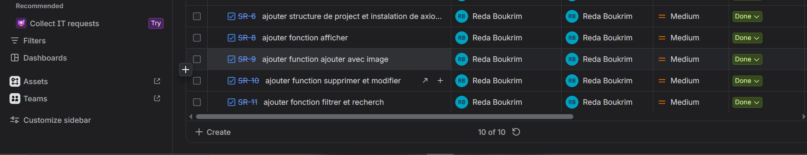
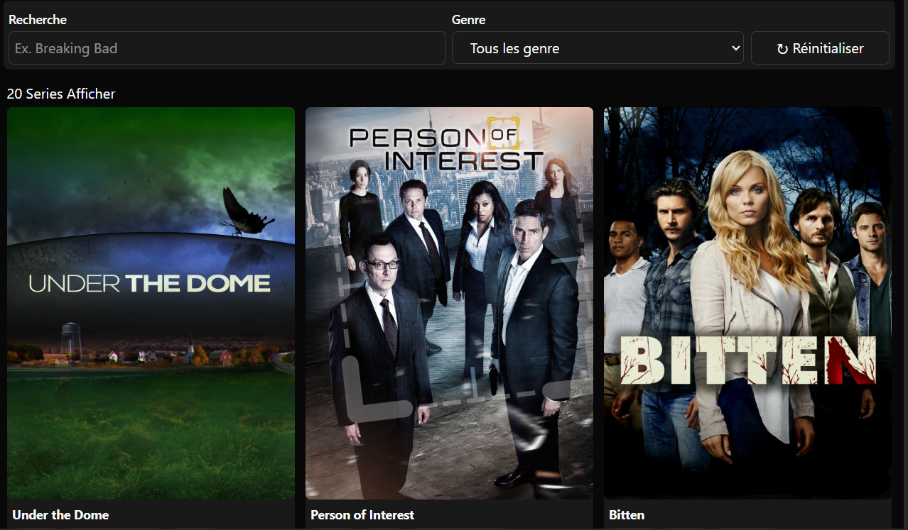

# SérieScope – Party 2

## 📖 Présentation du projet

SérieScope est une application web permettant de consulter et de gérer un catalogue de séries.

Cette deuxième version améliore le projet initial en intégrant une API distante pour assurer la persistance des données et permettre une gestion complète du catalogue grâce aux opérations CRUD.

L'application permet aux utilisateurs de rechercher, filtrer, ajouter, modifier et supprimer des séries. Toutes les opérations sont enregistrées côté serveur et les données restent disponibles après le rechargement de la page.




## 🎯 Objectifs du projet

- Migrer les requêtes HTTP de Fetch vers Axios.
- Mettre en place une architecture organisée en plusieurs couches.
- Communiquer avec l'API SérieScope.
- Implémenter les opérations CRUD.
- Ajouter la recherche et les filtres côté serveur.
- Gérer les erreurs HTTP, réseau et timeout.
- Conserver les critères de recherche et de filtrage dans LocalStorage.
- Améliorer l'expérience utilisateur et l'accessibilité.

## ✨ Fonctionnalités

### 1. Consultation du catalogue
- Affichage des séries depuis l'API.
- Présentation des informations sous forme de cartes.
- Rechargement des données depuis le serveur.

### 2. Recherche et filtrage
- Recherche par nom de série.
- Filtrage par genre.
- Filtrage par langue.
- Combinaison des différents critères.
- Réinitialisation des filtres.
- Affichage d'un message lorsqu'aucune série ne correspond aux critères.

### 3. Ajout d'une série – Create
- Ajout d'une nouvelle série.
- Validation des champs du formulaire.
- Enregistrement via une requête POST.
- Affichage des messages de confirmation et des erreurs.
- Indicateur de chargement pendant l'envoi.

### 4. Modification d'une série – Update
- Récupération des informations d'une série par son identifiant.
- Préremplissage du formulaire.
- Modification des informations.
- Enregistrement des changements sur le serveur.

### 5. Suppression d'une série – Delete
- Suppression d'une série depuis sa carte.
- Confirmation avant la suppression.
- Actualisation du catalogue après la suppression.


## 🛠️ Technologies utilisées

- HTML5
- Tailwind CSS
- JavaScript (ES6+)
- Axios
- LocalStorage
- API SérieScope
- Git & GitHub
- GitFlow

## 🏗️ Architecture du projet

```text
SérieScope/
│
├── assets/
│   └── images/
│
├── src/
│   ├── services/
│   │   ├── api.js
│   │   └── serieService.js
│   │
│   ├── data/
│   │   └── store.js
│   │
│   ├── ui/
│   │   ├── cards.js
│   │   ├── form.js
│   │   ├── filters.js
│   │   └── notify.js
│   │
│   ├── input.css
│   └── main.js
│
├── index.html
├── package.json
└── README.md
```

### Organisation des couches

| Fichier | Responsabilité |
|---|---|
| `api.js` | Configuration de l'instance Axios |
| `serieService.js` | Communication avec l'API et opérations CRUD |
| `store.js` | Gestion de l'état et des critères de filtrage |
| `cards.js` | Affichage des cartes des séries |
| `form.js` | Gestion du formulaire d'ajout et de modification |
| `filters.js` | Gestion de la recherche et des filtres |
| `notify.js` | Affichage des notifications |
| `main.js` | Point d'entrée et coordination des modules |

## 🌐 API utilisée

L'application communique avec l'API SérieScope :

`https://seriescope-api.vercel.app/api`

| Méthode HTTP | Endpoint | Description |
|---|---|---|
| GET | `/series` | Récupérer les séries |
| GET | `/series/:id` | Récupérer une série par ID |
| POST | `/series` | Ajouter une série |
| PATCH | `/series/:id` | Modifier une série |
| DELETE | `/series/:id` | Supprimer une série |

Les paramètres de recherche et de filtrage sont envoyés à travers les paramètres de requête :

- `name`
- `genre`
- `language`

## 🌿 Gestion de version – GitFlow

Le projet est organisé selon la méthode GitFlow :

- `main` : version stable du projet.
- `develop` : branche principale de développement.
- `feature/axios-service` : intégration d'Axios et des services.

Chaque fonctionnalité est développée dans une branche dédiée puis intégrée à `develop` via une Pull Request.
## live Demo 
https://github.com/rida-boukrim/S-rieScope-.git


# S-rieScope-

##  Présentation du projet



**Movie & Series Library** est une application web permettant aux utilisateurs de découvrir, consulter et gérer une collection de films et de séries.

L'application offre une interface simple et intuitive permettant de visualiser les informations de chaque film ou série, notamment son titre, son genre et son résumé (*description*).

Les utilisateurs peuvent également ajouter de nouveaux contenus et rechercher leurs films et séries préférés.

##  Fonctionnalités principales

- **Affichage des films et séries :** Consulter une collection de films et de séries avec leurs informations et leurs résumés.
- **Ajout de films et séries :** Ajouter de nouveaux contenus à l'aide d'un formulaire.
- **Gestion des genres :** Sélectionner un genre lors de l'ajout d'un film ou d'une série.
- **Recherche :** Rechercher un film ou une série par son titre.
- **Filtrage par genre :** Afficher uniquement les films et séries appartenant au genre sélectionné.
- **Description :** Consulter un résumé pour chaque film ou série.

## 🛠️ Technologies utilisées

| Technologie | Utilisation |
|---|---|
| HTML5 | Structure de l'application |
| Tailwind CSS | Mise en forme et design responsive |
| JavaScript | Fonctionnalités et interactions dynamiques |
| Git & GitHub | Gestion de versions et collaboration |
| GitHub Pages | Hébergement de l'application |
| Jira | Gestion et suivi des tâches |


## 🌿 Gestion des branches – Git Flow

Pour organiser le développement du projet, nous avons utilisé une approche inspirée de **Git Flow**, avec les branches suivantes :

- **main :** Contient la version stable et finale du projet.
- **develop :** Branche principale de développement, où les fonctionnalités sont intégrées.
- **feature/formulaire :** Branche dédiée au développement du formulaire d'ajout de films et de séries.


## 📋 Gestion du projet

Nous avons utilisé **Jira** pour organiser le travail, répartir les tâches et suivre l'avancement du projet.


## 🚀 Démonstration

🔗 **Live Demo : https://rida-boukrim.github.io/S-rieScope-/
